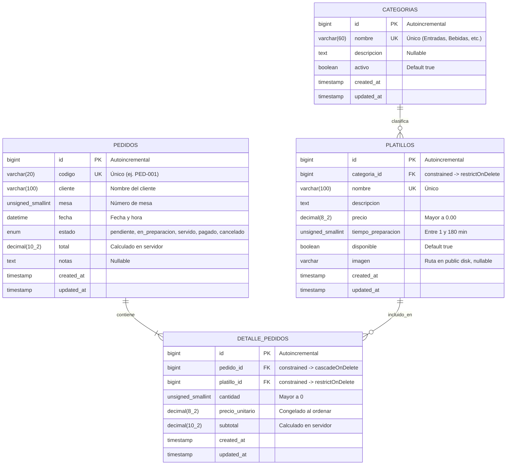

# Sistema de Gestión de Restaurante: Menú y Pedidos
### Caso 5 · Proyecto Final — Desarrollo Web con Software Libre
**Universidad Católica de El Salvador (UNICAES)**  
**Facultad de Ingeniería y Arquitectura**

---

## 1. Integrantes del Equipo (Grupo 5)

| Nombre Completo | Usuario de GitHub | Rol en el Proyecto |
| :--- | :--- | :--- |
| **Rodolfo Rivas** | `@rodolforivas` | Arquitectura inicial, Docker, Migraciones BD, Diagrama ER y Documentación |
| **Diego** | `@[usuario_github_diego]` | Modelos Eloquent, Encapsulamiento y Relaciones |
| **Miguel** | `@[usuario_github_miguel]` | Seeders y Factories de datos de prueba |
| **Kendel** | `@[usuario_github_kendel]` | Rutas, Controlador de Platillos, Layout Blade y Vistas |

*Docente colaboradora agregada al repositorio:* Docente de la asignatura.

---

## 2. Descripción del Sistema y Alcance por Fases

El sistema permite administrar el catálogo de platillos del menú de un restaurante y gestionar los pedidos realizados por los clientes con sus respectivos renglones de detalle. 

### Alcance de la Fase 1 (Entrega inicial ~30% - 50%):
- Configuración del entorno Laravel 13 con contenedor Docker para MySQL 8.0 y `.env.example`.
- Diseño e implementación completa de la base de datos relacional mediante migraciones de Laravel:
  - Catálogo: `categorias` (1:N con platillos).
  - Entidad principal: `platillos` (CRUD completo a implementar).
  - Entidades de pedidos: `pedidos` y `detalle_pedidos` (relación N:M con datos adicionales en la tabla pivote).
- Modelos Eloquent con relaciones (`belongsTo`, `hasMany`, `belongsToMany`), `$fillable` y `$casts`.
- Datos de prueba con Seeders y Factories (mínimo 15 platillos reales/realistas y categorías de restaurante).
- Controlador `PlatilloController` con métodos `index` (listado paginado con categoría) y `show` (ficha de detalle).
- Vistas Blade con layout común reutilizable (`layouts/app.blade.php`), diseño CSS propio responsivo (`public/css/estilos.css`) y soporte de imagen por defecto.
- Documentación con etiquetas de concepto `[CONCEPTO]` en el código fuente.

### Alcance de la Fase 2 (100% - Proyecto Final):
- Operaciones completas de escritura del CRUD (`create`, `store`, `edit`, `update`, `destroy` con método DELETE).
- Subida, reemplazo y eliminación física de fotografías con `Storage` y `storage:link`.
- Form Requests con validación estricta en servidor y mensajes de error en español.
- Registro y gestión de pedidos con detalle y cálculo de totales en servidor.
- Panel de control e indicadores agregados (ventas del día, platillos más vendidos, ticket).

---

## 3. Requisitos del Entorno

- **PHP:** 8.3 o superior (recomendado 8.3+)
- **Composer:** Versión 2.x
- **Extensiones PHP obligatorias:** `pdo_mysql`, `mbstring`, `openssl`, `tokenizer`, `xml`, `ctype`, `json`, `curl`, `fileinfo`.
- **Motor de Base de Datos:** MySQL 8.0 (mediante Docker Compose incluido) o MariaDB / MySQL local (XAMPP / Laragon).
- **Docker & Docker Compose** (opcional pero recomendado para reproducibilidad exacta).

---

## 4. Instalación Paso a Paso

Sigue estos pasos en tu terminal para poner en marcha el proyecto localmente:

### 1. Clonar el repositorio
```bash
git clone https://github.com/TU-ORGANIZACION/proyecto-final-laravel-equipo5.git
cd proyecto-final-laravel-equipo5
```

### 2. Instalar dependencias de PHP
```bash
composer install
```

### 3. Configurar variables de entorno
Copia la plantilla de entorno:
```bash
cp .env.example .env
```
Genera la llave de la aplicación:
```bash
php artisan key:generate
```

### 4. Iniciar la base de datos con Docker
Si utilizas Docker, levanta el contenedor de MySQL 8.0:
```bash
docker compose up -d
```
*(Si usas XAMPP o Laragon, asegúrate de iniciar el servicio MySQL y crear una base de datos llamada `restaurante_db`)*.

Verifica que las credenciales en tu archivo `.env` coincidan:
```env
DB_CONNECTION=mysql
DB_HOST=127.0.0.1
DB_PORT=3306
DB_DATABASE=restaurante_db
DB_USERNAME=restaurante_user
DB_PASSWORD=restaurante_password
```

### 5. Ejecutar migraciones y poblar la base de datos
```bash
php artisan migrate:fresh --seed
```

### 6. Enlazar el almacenamiento público (para imágenes)
```bash
php artisan storage:link
```

### 7. Iniciar el servidor local de desarrollo
```bash
php artisan serve
```
Abre tu navegador en [http://localhost:8000](http://localhost:8000) o la ruta de platillos en [http://localhost:8000/platillos](http://localhost:8000/platillos).

---

## 5. Diagrama Entidad-Relación



### Explicación de restricciones e integridad referencial:
- **`categorias` -> `platillos`:** `restrictOnDelete()` impide eliminar una categoría si existen platillos vinculados a ella, preservando la integridad del catálogo.
- **`pedidos` -> `detalle_pedidos`:** `cascadeOnDelete()` asegura que al eliminar un pedido se borren automáticamente todas sus líneas de detalle.
- **`platillos` -> `detalle_pedidos`:** `restrictOnDelete()` protege los registros históricos de pedidos impidiendo que se elimine un platillo que ya ha sido facturado.
- **Unicidad:** El nombre del platillo es único en la carta (`unique`), así como el código del pedido y el nombre de la categoría.

---

## 6. Reglas de Negocio del Caso 5

| Regla de Negocio | Fase | Dónde se valida / implementa |
| :--- | :---: | :--- |
| **Precio mayor que 0** | F2 | `StorePlatilloRequest` y `UpdatePlatilloRequest` (`numeric`, `gt:0`). |
| **Tiempo de preparación entre 1 y 180 min** | F2 | Form Requests (`integer`, `between:1,180`). |
| **Nombre del platillo único** | F1 / F2 | Restricción en migración `unique()` y regla `Rule::unique('platillos')`. |
| **Cantidad entera mayor que 0 en detalle** | F2 | `StorePedidoRequest` (`integer`, `min:1`). |
| **No agregar platillos no disponibles** | F2 | Validación en el controlador de pedidos (`Rule::exists()->where('disponible', true)`). |
| **Subtotal y total calculados en el servidor** | F2 | Controlador `PedidoController`: cálculo matemático estricto en backend sin confiar en datos de cliente. |

---

## 7. Etiquetas `[CONCEPTO]` en el Código

| Etiqueta | Archivo de Ejemplo | Propósito |
| :--- | :--- | :--- |
| `[MIGRACION]` | `database/migrations/2026_11_02_181033_create_platillos_table.php` | Marca la creación de tablas con tipos adecuados y llaves. |
| `[RELACION]` | `database/migrations/..._create_platillos_table.php` y `app/Models/Platillo.php` | Llaves foráneas y métodos `belongsTo`, `hasMany`, `belongsToMany`. |
| `[ENCAPSULAMIENTO]` | `app/Models/Platillo.php` | `$fillable` y `$casts` para protección contra asignación masiva. |
| `[CRUD-READ]` | `app/Http/Controllers/PlatilloController.php` | Métodos `index()` y `show()` con Route Model Binding y paginación. |

---

## 8. Distribución del Trabajo

### Fase 1:
- **Rodolfo Rivas:**
  - Configuración del proyecto Laravel 13, contenedor Docker MySQL 8.0, persistencia y `.env.example`.
  - Creación de migraciones de base de datos (`categorias`, `platillos`, `pedidos`, `detalle_pedidos`) con restricciones de integridad.
  - Diseño del Diagrama Entidad-Relación en Mermaid y redacción del README inicial.
  - Hoja de ruta y guía de tareas para el equipo (`TAREAS_EQUIPO_FASE1.txt`).
- **Diego:**
  - Creación de Modelos Eloquent (`Categoria`, `Platillo`, `Pedido`, `DetallePedido`) con propiedades `$fillable`, `$casts` y métodos de relación bidireccionales.
- **Miguel:**
  - Implementación de `CategoriaSeeder` (catálogos de entradas, platos fuertes, bebidas, postres) y `PlatilloFactory` con datos de prueba realistas (mínimo 15 platillos).
- **Kendel:**
  - Implementación de `PlatilloController` (métodos `index` y `show`), definición de rutas y maquetación de vistas Blade (`layouts/app.blade.php`, `platillos/index.blade.php`, `platillos/show.blade.php`).

---

## 9. Capturas de Pantalla

*(Espacio reservado para las capturas del listado paginado y la ficha de detalle de la Fase 1)*.
