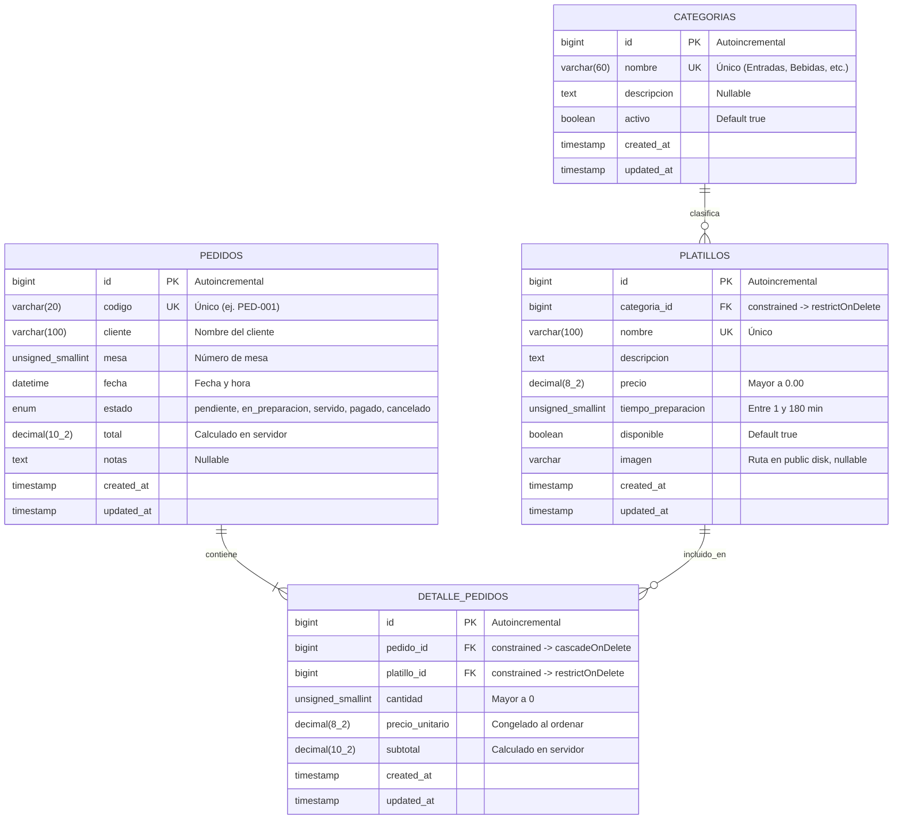
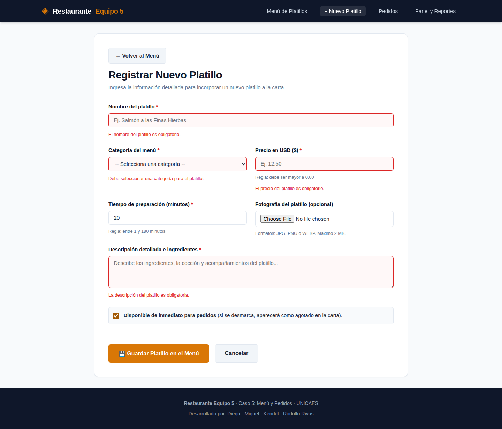
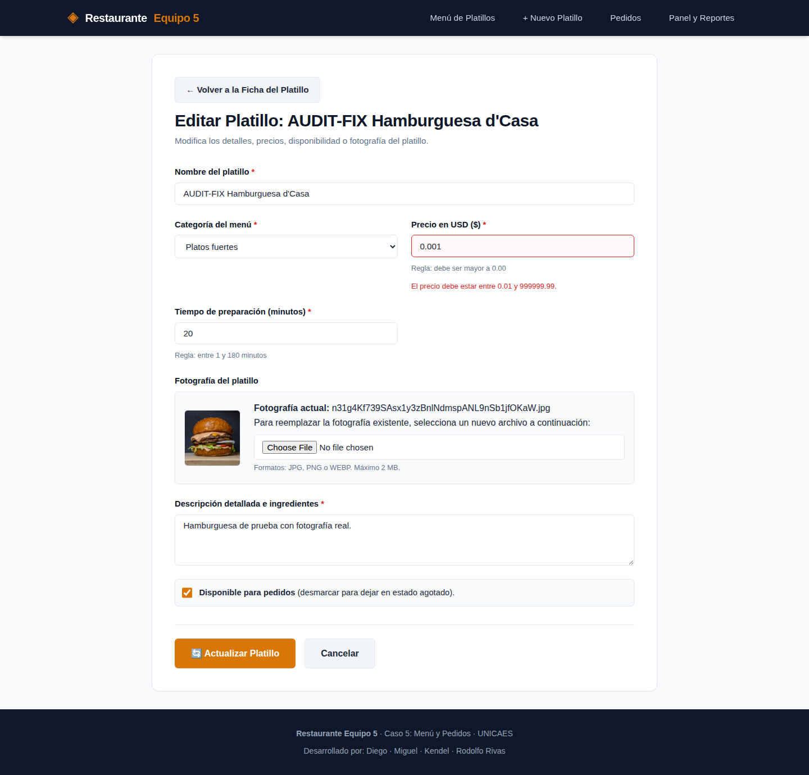
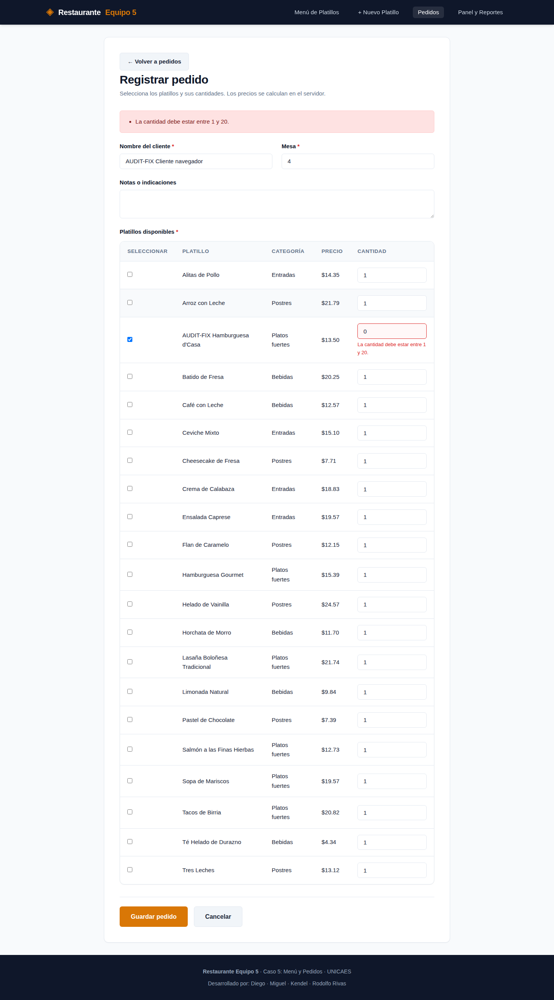

# Sistema de Gestión de Restaurante: Menú y Pedidos
### Caso 5 · Proyecto Final — Desarrollo Web con Software Libre
**Universidad Católica de El Salvador (UNICAES)**  
**Facultad de Ingeniería y Arquitectura**

---

## 1. Integrantes del Equipo (Grupo 5)

| Nombre Completo | Usuario de GitHub | Rol en el Proyecto |
| :--- | :--- | :--- |
| **Rodolfo Rivas** | `@rodolforivas` | Arquitectura inicial, Docker, Migraciones BD, CRUD Platillos, Form Requests, Manejo de Imágenes y Documentación |
| **Diego** | `@[usuario_github_diego]` | Modelos Eloquent, Relaciones, Módulo de Pedidos y Detalle (Fase 2) |
| **Miguel** | `@[usuario_github_miguel]` | Rutas base, Panel de control, Reportes de ventas y Seeders de pedidos (Fase 2) |
| **Kendel** | `@KendelJhoel` | Seeders iniciales, Form Requests de pedidos, Vistas Blade y Diseño responsivo móvil (Fase 2) |

*Docente colaboradora agregada al repositorio:* Docente de la asignatura.

---

## 2. Descripción del Sistema y Alcance por Fases

El sistema permite administrar el catálogo de platillos del menú de un restaurante y gestionar los pedidos realizados por los clientes con sus respectivos renglones de detalle. 

### Alcance de la Fase 1 (Entrega inicial ~30% - 50%):
- Configuración del entorno Laravel 13 con contenedor Docker para MySQL 8.0 y `.env.example`.
- Diseño e implementación completa de la base de datos relacional mediante migraciones de Laravel:
  - Catálogo: `categorias` (1:N con platillos).
  - Entidad principal: `platillos` (CRUD completo a implementar).
  - Entidades de pedidos: `pedidos` y `detalle_pedidos` (relación N:M con datos adicionales en la tabla pivote).
- Modelos Eloquent con relaciones (`belongsTo`, `hasMany`, `belongsToMany`), `$fillable` y `$casts`.
- Datos de prueba con Seeders y Factories (mínimo 15 platillos reales/realistas y categorías de restaurante).
- Controlador `PlatilloController` con métodos `index` (listado paginado con categoría) y `show` (ficha de detalle).
- Vistas Blade con layout común reutilizable (`layouts/app.blade.php`), diseño CSS propio responsivo (`public/css/estilos.css`) y soporte de imagen por defecto.
- Documentación con etiquetas de concepto `[CONCEPTO]` en el código fuente.

### Alcance de la Fase 2 (100% - Proyecto Final):
- Operaciones completas de escritura del CRUD (`create`, `store`, `edit`, `update`, `destroy` con método DELETE).
- Subida, reemplazo y eliminación física de fotografías con `Storage` y `storage:link`.
- Form Requests con validación estricta en servidor y mensajes de error en español (`StorePlatilloRequest`, `UpdatePlatilloRequest`).
- Buscador por texto y filtros por categoría y disponibilidad en el menú.
- Registro y gestión de pedidos con detalle y cálculo de subtotales y total en servidor.
- Panel de control e indicadores agregados (ventas del día, platillos más vendidos, ticket).

---

## 3. Requisitos del Entorno

- Docker Desktop encendido, con contenedores Linux y Docker Compose.
- Git para clonar el repositorio.
- No hace falta instalar PHP, Composer, MySQL ni Node en la computadora si se usa Docker Compose.
- La imagen Docker incluye GD (JPEG, PNG, WebP) e intl para imágenes y diagnósticos.

Laravel y PHP corren en `restaurante_app`; MySQL 8 corre en `restaurante_mysql`.
La aplicación conecta a `mysql:3306` dentro de la red de Compose. Las pruebas usan SQLite en memoria dentro del contenedor, aislado de MySQL.

---

## 4. Instalación, encendido y apagado

Ejecutar desde la carpeta del proyecto, con Docker Desktop listo:

```bash
git clone https://github.com/FOFOCode/proyecto-final-laravel-equipo5.git
cd proyecto-final-laravel-equipo5
cp .env.example .env
docker compose up -d --build --wait
docker compose exec app php artisan key:generate
docker compose restart app
docker compose exec app php artisan migrate --seed --force
docker compose exec app php artisan storage:link
```

Abrir **http://localhost:8000/platillos**.

---

## 5. Diagrama Entidad-Relación



---

## 6. Reglas de Negocio del Caso 5

| Regla de Negocio | Fase | Dónde se valida / implementa |
| :--- | :---: | :--- |
| **Precio mayor que 0** | F2 | `StorePlatilloRequest` y `UpdatePlatilloRequest` (`numeric`, `between:0.01,999999.99`, `decimal:0,2`). |
| **Tiempo de preparación entre 1 y 180 min** | F2 | `StorePlatilloRequest` y `UpdatePlatilloRequest` (`integer`, `between:1,180`). |
| **Nombre del platillo único** | F1 / F2 | Restricción en migración `unique()` y reglas `unique:platillos,nombre` e `ignore()` en actualización. |
| **Cantidad entera mayor que 0 en detalle** | F2 | `StorePedidoRequest` (`integer`, `min:1`). |
| **No agregar platillos no disponibles** | F2 | Controlador de pedidos `PedidoController` y validación `disponible = true`. |
| **Subtotal y total calculados en el servidor** | F2 | Controlador `PedidoController`: cálculo estricto en backend sin confiar en datos de cliente. |
| **Integridad referencial de platillos** | F2 | `PlatilloController@destroy`: no se puede eliminar un platillo que esté asociado a pedidos. |

---

## 7. Documentación con Etiquetas `[CONCEPTO]` en el Código

| Etiqueta | Archivo de Ejemplo | Propósito |
| :--- | :--- | :--- |
| `[MIGRACION]` | `database/migrations/2026_11_02_181033_create_platillos_table.php` | Marca la creación de tablas con tipos adecuados y llaves foráneas. |
| `[RELACION]` | `app/Models/Platillo.php` y `app/Models/Pedido.php` | Métodos de relación Eloquent (`belongsTo`, `hasMany`, `belongsToMany`). |
| `[ENCAPSULAMIENTO]` | `app/Models/Platillo.php` | Propiedades `$fillable` y `$casts` para protección contra asignación masiva. |
| `[CRUD-READ]` | `app/Http/Controllers/PlatilloController.php` | Métodos `index()` y `show()` con Route Model Binding y paginación. |
| `[CRUD-CREATE]` | `app/Http/Controllers/PlatilloController.php` | Método `store()` con Form Request y guardado de imagen. |
| `[CRUD-UPDATE]` | `app/Http/Controllers/PlatilloController.php` | Método `update()` con reemplazo de imagen y eliminación del archivo previo. |
| `[CRUD-DELETE]` | `app/Http/Controllers/PlatilloController.php` | Método `destroy()` protegido por verbo HTTP `DELETE` y validación de pedidos. |
| `[VALIDACION]` | `app/Http/Requests/StorePlatilloRequest.php` | Form Requests con reglas estrictas y mensajes en español por campo. |
| `[REGLA-NEGOCIO]` | `app/Http/Requests/StorePlatilloRequest.php` y `PlatilloController.php` | Reglas de negocio del restaurante validadas en el servidor. |
| `[SEGURIDAD]` | `resources/views/platillos/create.blade.php`, `index.blade.php` | Directivas `@csrf`, `@method('DELETE')`, escape automático con `{{ }}` y `$request->validated()`. |
| `[INYECCION-DEPENDENCIAS]` | `app/Http/Controllers/PlatilloController.php` | Parámetros automáticos inyectados por Laravel (`StorePlatilloRequest`, `Request`, `Platillo`). |

---

## 8. Distribución del Trabajo

### Fase 1:
- **Rodolfo Rivas:**
  - Configuración inicial de Laravel 13, contenedor Docker MySQL 8.0, persistencia y `.env.example`.
  - Creación de migraciones completas de base de datos (`categorias`, `platillos`, `pedidos`, `detalle_pedidos`) con restricciones de integridad.
  - Diseño del Diagrama Entidad-Relación en Mermaid y redacción del README inicial.
  - Hoja de ruta y guía de tareas para el equipo (`TAREAS_EQUIPO_FASE1.txt`).
- **Diego:**
  - Creación de Modelos Eloquent (`Categoria`, `Platillo`, `Pedido`, `DetallePedido`) con propiedades `$fillable`, `$casts` y métodos de relación bidireccionales.
- **Kendel:**
  - Implementación de `CategoriaSeeder` (catálogos de entradas, platos fuertes, bebidas, postres) y `PlatilloFactory` con datos de prueba realistas (mínimo 15 platillos).
- **Miguel:**
  - Implementación inicial de `PlatilloController` (métodos `index` y `show`), definición de rutas y maquetación de vistas Blade (`layouts/app.blade.php`, `platillos/index.blade.php`, `platillos/show.blade.php`).

### Fase 2:
- **Rodolfo Rivas (Avance Inicial Fase 2):**
  - Implementación del CRUD completo de Platillos (`create`, `store`, `edit`, `update`, `destroy` mediante HTTP `DELETE`).
  - Creación de Form Requests en servidor con mensajes en español (`StorePlatilloRequest` y `UpdatePlatilloRequest`).
  - Gestión integral de imágenes con Laravel `Storage`: subida, reemplazo sin dejar archivos huérfanos y eliminación física en borrado.
  - Motor de búsqueda por texto y filtros por categoría y disponibilidad en el listado del menú.
  - Alertas flash de éxito y error en el layout principal.
  - Suite de pruebas automatizadas y redacción de la guía `TAREAS_EQUIPO_FASE2.txt`.
- **Diego:**
  - Módulo de Pedidos y Detalle (`PedidoController` con `index`, `create`, `store`, `show`, `updateEstado`), transacciones `DB::transaction` y cálculo estricto de subtotales y total en backend.
- **Miguel:**
  - Panel de control y reportes (`PanelController` con métricas de ventas del día, ranking de platillos más vendidos y tickets recientes) más `PedidoSeeder` para datos de prueba.
- **Kendel:**
  - Form Requests de pedidos (`StorePedidoRequest`), maquetación de vistas de pedidos (`pedidos/index.blade.php`, `pedidos/create.blade.php`, `pedidos/show.blade.php` con ticket imprimible) y diseño responsive adaptativo a móviles.

---

## 9. Capturas de Pantalla

Capturas verificadas en Chromium dentro de Docker el 12/11/2026. Los registros `AUDIT-FIX` son datos temporales de prueba y fueron retirados al terminar.

| Página | Captura |
|---|---|
| Menú y filtros | [Menú](docs/capturas/menu-1440.png) |
| Alta con fotografía | [Crear platillo](docs/capturas/crear-platillo.png) |
| Ficha con fotografía | [Detalle](docs/capturas/detalle-platillo.png) |
| Edición y reemplazo de imagen | [Editar](docs/capturas/editar-platillo.png) |
| Listado, estados y paginación | [Pedidos](docs/capturas/pedidos-1440.png) |
| Selección parcial de platillos | [Registrar pedido](docs/capturas/crear-pedido.png) |
| Ticket imprimible | [Ticket](docs/capturas/ticket.png) |
| Indicadores y reportes | [Panel](docs/capturas/panel-1440.png) |
| Confirmación de eliminación | [Borrado](docs/capturas/eliminar-exito.png) |

Validaciones del servidor, con los valores conservados:





Diseño móvil: [edición con imagen](docs/capturas/editar-375.png), [pedidos](docs/capturas/pedidos-375.png) y [panel](docs/capturas/panel-375.png).

---

## 10. Pruebas Automatizadas

Para ejecutar la suite completa de pruebas:

```bash
docker compose exec app php artisan test
```

La suite incluye 35 pruebas de características y unitarias que cubren:
- Paginación del menú y carga anticipada de categorías.
- Ficha de detalle con fotografía o imagen por defecto.
- Escape seguro contra inyecciones XSS.
- Formulario de creación y almacenamiento de platillos con subida de archivos a Storage.
- Validación de reglas de negocio en el servidor (precio > 0, tiempo 1 a 180 min, nombre único).
- Formulario de edición con datos precargados y reemplazo de imagen anterior.
- Eliminación segura mediante petición HTTP `DELETE`.
- Bloqueo de eliminación por integridad referencial cuando un platillo está presente en pedidos.
- Búsqueda por texto y filtros de categoría y disponibilidad.

---

## 11. Cambios respecto a la Fase 1

En cumplimiento con los requisitos de la rúbrica de la Fase 2, se detallan los siguientes cambios y ampliaciones incorporados sobre el código base de la Fase 1:

1. **Habilitación de Operaciones de Escritura en Platillos:** Se habilitaron las rutas de recurso completas (`create`, `store`, `edit`, `update`, `destroy`), sustituyendo el controlador de solo lectura de la primera entrega.
2. **Validación en Servidor con Form Requests:** Se crearon `StorePlatilloRequest` y `UpdatePlatilloRequest` con validación estricta y mensajes de error en español para todos los campos, verificando que los errores se muestren junto a cada control y que los valores ingresados se conserven con `old()`.
3. **Manejo de Imágenes con Storage:** Se implementó la subida física de imágenes a `storage/app/public/platillos`, la eliminación automática de fotografías previas al actualizar y la eliminación del archivo al destruir un platillo para evitar archivos huérfanos.
4. **Búsqueda y Filtros en el Listado:** Se agregó una barra de filtros multicriterio que permite buscar por texto y filtrar simultáneamente por categoría del catálogo y estado de disponibilidad, preservando los parámetros en la paginación con `withQueryString()`.
5. **Alertas Flash en el Layout:** Se integraron componentes de alerta para `session('exito')` y `session('error')` en `layouts/app.blade.php`.
6. **Protección de Integridad:** Se programó una verificación que impide eliminar registros de platillos si ya forman parte de líneas de pedidos en la tabla intermedia `detalle_pedidos`.

## 12. Configuración y verificación de las correcciones

Después de modificar código, reconstruir el contenedor: `docker compose up -d --build --wait`. El código se copia a la imagen; reiniciar solamente no incorpora cambios. Los volúmenes conservan la base y las fotografías.

- Ejecutar pruebas: `docker compose exec app php artisan test`. `phpunit.xml` fuerza SQLite en memoria y `tests/TestCase.php` bloquea otras conexiones antes de migrar. No usar la base de la aplicación para `RefreshDatabase`.
- Diagnóstico: `docker compose exec app php artisan db:show`.
- Ventas: importe de todos los pedidos no cancelados, incluidos los no pagados. Atendidos: histórico de servidos y pagados. Se permite cambiar cualquier estado para corregir pedidos.
- Fechas: almacenamiento UTC, presentación y día del panel en `America/El_Salvador`. Se puede configurar `APP_DISPLAY_TIMEZONE` en `.env` y reiniciar la app.
- Fotografías: JPEG, PNG o WebP, hasta 2 MB. PHP admite recibir hasta 4 MB para que Laravel pueda mostrar el error de tamaño en español.
- Apagado sin perder datos: `docker compose down`. Encendido: `docker compose up -d --wait`.
- Si el puerto 8080 está ocupado, liberar ese puerto o cambiar únicamente el puerto publicado de phpMyAdmin antes de levantar Compose.